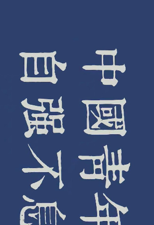
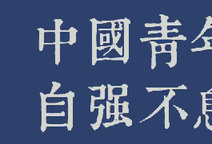

# 照片编辑来源验证实验

王科文 · 2026 年 10 月

**照片经过裁剪、缩小和旋转后，不公开原图，能否验证它来自已签名的原图？**

本项目从 [drakstik/PhotoProof](https://github.com/drakstik/PhotoProof) 的 Go 演示出发，记录原代码复现、问题验证，以及新增的图像编辑证明实验。

## 实验总结入口

- **[最开始的原仓库复现实验总结](experiment-results/实验记录.md)**：原代码连续运行 3 次的结果、耗时，以及发现的问题。
- [原仓库的真实图片对照实验](experiment-results/real-photo/真实图片实验.md)：为什么原来的证明检查不能可靠识别编辑后的图片。
- [后续新增方案的实验总结](experiment-results/pixel-auth/本次结果.md)：裁剪、缩小、旋转和连续编辑的真实图片验证。

## 实际达到了什么效果

使用一张 1440×810 的真实照片，连续进行了两轮裁剪、最近邻缩小和直角旋转。验证者只拿最终图片、证明和可信配置，不需要原图或中间图片，验证通过。修改最终图片的一个像素，验证失败。

| 实验 | 结果 |
| --- | --- |
| 按规则完成两轮编辑 | 通过 |
| 修改最终图片的一个像素或添加红色方块 | 拒绝 |
| 篡改之前的裁剪、缩放取样或旋转参数 | 拒绝 |
| 修改证明并更新文件摘要 | 拒绝 |
| 不提供原图和中间图片，单独验证最终结果 | 通过 |

[完整实验记录与实测数据](experiment-results/pixel-auth/本次结果.md) · [11 项检查记录](experiment-results/pixel-auth/checks.json) · [运行日志](experiment-results/pixel-auth/real-photo-tests.log)

## 看一个实际例子

原图先进行签名。第一轮从 (137,83) 裁出 901×617，缩小到 451×309，再旋转 90°；第二轮在上一张图上继续裁剪、缩小和旋转。

| 第一轮结果：309×451 | 最终结果：265×181 |
| --- | --- |
|  |  |

可以把最终图片理解为交给老师的图片。老师检查证明后，能够确认它符合签名者允许的编辑规则。偷偷修改一个像素，原来的证明就无法通过。

这里证明的是**图片的来源与编辑过程**，不能证明照片中的事情本身真实。仓库公开了实验用的 [1.JPG](1.JPG)，方便复现；实际验证流程不需要读取它。若要对外公开仓库，请先确认这张照片适合公开。

## 怎么运行

需要 Go 环境；本机实测版本为 Go 1.27.2，项目模块声明 Go 1.20。首次运行需要联网下载 Go 依赖。

在仓库根目录执行：

```sh
bash scripts/reproduce.sh
```

脚本会生成新的签名和参数，完成两轮真实图片编辑、11 项对照检查，以及只使用最终图片和证明的独立验证。结果保存到 `runs/` 下的新目录，不覆盖已有实验。

Apple M1、16 GB 内存上的一次实测：初始化约 33 秒，第一轮证明生成约 3.07 秒，第二轮约 0.42 秒，两轮完整证明验证约 1.94 秒。整个复现脚本还包含重复验证和测试，耗时会更长。

只运行常规测试：

```sh
cd src
go test ./... -count=1
```

单独运行某一步、查看证明公式：[实现说明与命令](src/pixelauth/README.md)。

## 当前限制

这是研究原型，尚未经过独立安全审查。

- 最新实验使用新增的像素承诺与 Schnorr 证明，**不是原项目 Groth16 或论文递归 PCD 的完整复现**。
- 支持整数坐标裁剪、最近邻缩小和 90°倍数旋转，不支持 JPEG 重压缩、任意角度旋转、滤镜等操作。
- 两轮证明合计约 41.78 MB，公共参数缓存约 111.97 MB。证明链尚未递归压缩，步骤越多，文件越大。
- 签名使用本机生成的实验密钥，尚未接入可信相机。验证方需要独立获得可信签名者配置。

仓库保留图片、代码、报告和日志；生成的二进制证明、参数缓存与私有编辑数据不进入 Git。复现脚本会重新生成它们，因此下载仓库后应先运行脚本，再验证新生成的证明包。

## 文件说明

| 路径 | 内容 |
| --- | --- |
| `src/pixelauth/`、`src/cmd/pixelproof/` | 最新像素编辑证明与命令行程序 |
| `scripts/reproduce.sh` | 完整真实图片实验入口 |
| `experiment-results/pixel-auth/` | 最新结果图片、报告与日志 |
| `src/cropauth/`、`src/flexauth/` | 早期裁剪与分块编辑实验 |
| `experiment-results/实验记录.md` | 从原代码复现到新增实验的过程 |
| `src/main.go`、`src/image/` | 保留的上游演示代码 |
| `upstream/` | 上游 README、课程报告和辅助示例 |

## 来源与贡献

本仓库新增了真实图片对照实验、裁剪及分块编辑版本、像素级连续编辑证明、复现脚本与实验记录。上游演示代码及其作者贡献保留，详见 [来源说明](UPSTREAM.md)。

参考论文：Assa Naveh and Eran Tromer. *PhotoProof: Cryptographic Image Authentication for Any Set of Permissible Transformations*. IEEE Symposium on Security and Privacy, 2016, pp. 255–271.

上传到自己的新仓库：[上传步骤](docs/上传到GitHub.md)。
